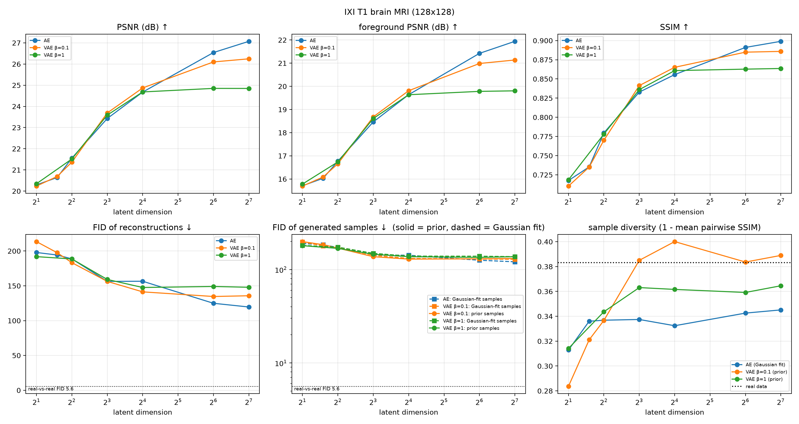
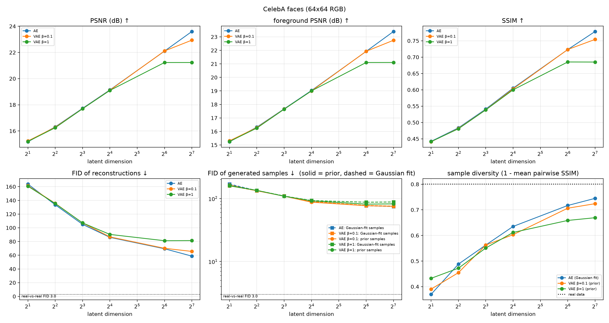
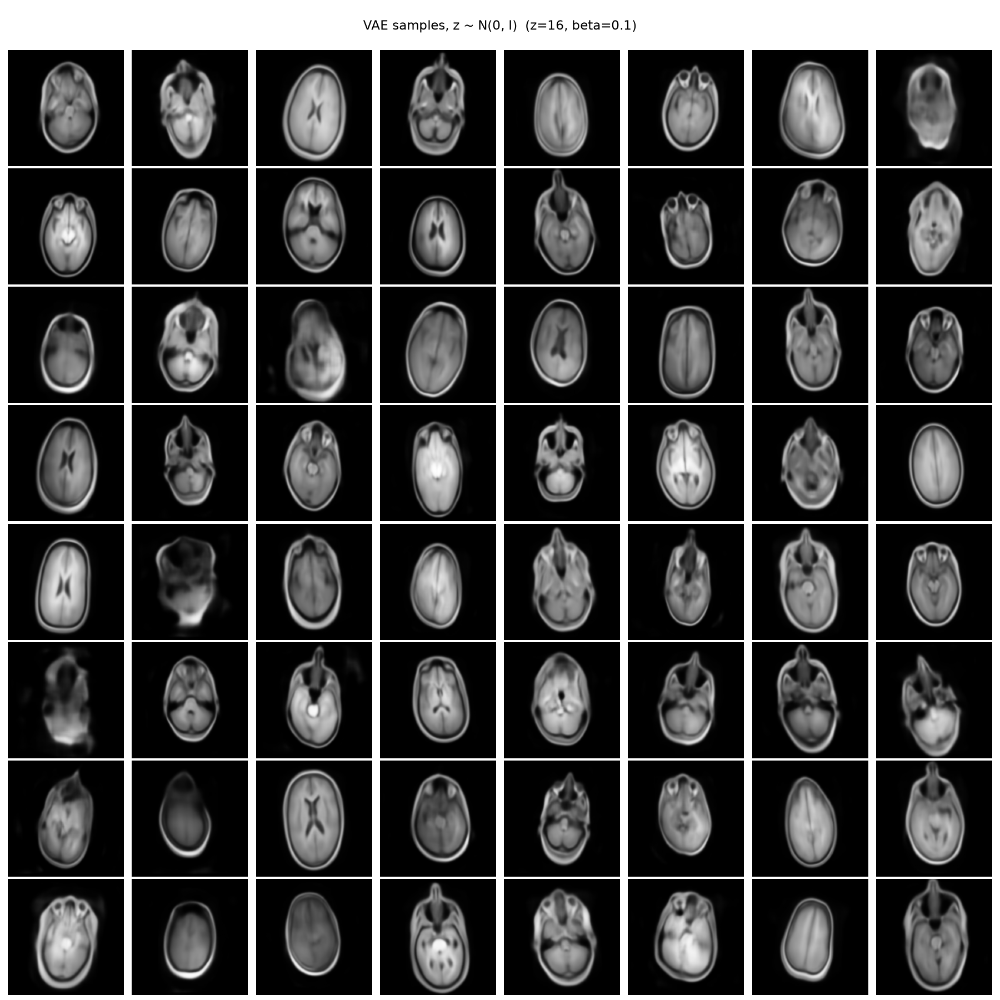

# MedLatent — Variational Autoencoders on brain MRI and faces (latent size 2 → 128)

Convolutional **variational autoencoders** trained with latent dimensions **2 to 128** on two very different datasets:
**IXI brain MRI** (healthy adults, T1 axial slices) and **CelebA** faces. They are part of a controlled AE-vs-VAE study:
same architecture, data, optimiser and schedule. The only differences are the latent layer and the KL term (β ∈ {0.1, 1}).

* Companion repo: **[Auto-Encoders](https://github.com/ChandraPrakash-Bathula/Auto-Encoders)** (weights: [medlatent-vae](https://huggingface.co/ChandraPrakashBathula/medlatent-vae))
* Interactive demo — latent clusters (PCA / t-SNE / UMAP, 2-D / 3-D), real vs generated images, latent walks, dataset comparison:
  **[MedLatent Studio](https://huggingface.co/spaces/ChandraPrakashBathula/medlatent-studio)**

> ⚠️ **Research models, not medical devices.** Reconstructions and generated brain images are not diagnostic images.

## Results (held-out test set)

### IXI brain MRI — 128×128 grayscale T1 slices
| run | z | β | PSNR (dB) | fg PSNR | SSIM | FID recon ↓ | FID prior samples ↓ | FID Gaussian-fit ↓ | active units | KL (nats) |
|---|---|---|---|---|---|---|---|---|---|---|
| [`ixi/z2_beta0.1`](https://huggingface.co/ChandraPrakashBathula/medlatent-vae/tree/main/ixi/z2_beta0.1) | 2 | 0.1 | 20.24 | 15.70 | 0.710 | 213.5 | 199.0 | 197.6 | 2/2 | 11.6 |
| [`ixi/z3_beta0.1`](https://huggingface.co/ChandraPrakashBathula/medlatent-vae/tree/main/ixi/z3_beta0.1) | 3 | 0.1 | 20.69 | 16.09 | 0.735 | 197.6 | 184.4 | 179.1 | 3/3 | 14.3 |
| [`ixi/z4_beta0.1`](https://huggingface.co/ChandraPrakashBathula/medlatent-vae/tree/main/ixi/z4_beta0.1) | 4 | 0.1 | 21.37 | 16.66 | 0.770 | 183.3 | 169.5 | 172.5 | 4/4 | 17.9 |
| [`ixi/z8_beta0.1`](https://huggingface.co/ChandraPrakashBathula/medlatent-vae/tree/main/ixi/z8_beta0.1) | 8 | 0.1 | 23.69 | 18.68 | 0.841 | 156.3 | 137.2 | 142.0 | 8/8 | 31.8 |
| [`ixi/z16_beta0.1`](https://huggingface.co/ChandraPrakashBathula/medlatent-vae/tree/main/ixi/z16_beta0.1) | 16 | 0.1 | 24.87 | 19.81 | 0.865 | 141.3 | 129.2 | 131.4 | 16/16 | 51.7 |
| [`ixi/z64_beta0.1`](https://huggingface.co/ChandraPrakashBathula/medlatent-vae/tree/main/ixi/z64_beta0.1) | 64 | 0.1 | 26.10 | 20.99 | 0.885 | 134.7 | 130.2 | 129.6 | 62/64 | 85.2 |
| [`ixi/z128_beta0.1`](https://huggingface.co/ChandraPrakashBathula/medlatent-vae/tree/main/ixi/z128_beta0.1) | 128 | 0.1 | 26.25 | 21.14 | 0.886 | 135.8 | 131.2 | 128.7 | 89/128 | 87.3 |
| [`ixi/z2_beta1`](https://huggingface.co/ChandraPrakashBathula/medlatent-vae/tree/main/ixi/z2_beta1) | 2 | 1 | 20.35 | 15.78 | 0.719 | 191.9 | 180.0 | 181.2 | 2/2 | 8.2 |
| [`ixi/z4_beta1`](https://huggingface.co/ChandraPrakashBathula/medlatent-vae/tree/main/ixi/z4_beta1) | 4 | 1 | 21.52 | 16.74 | 0.778 | 188.6 | 168.4 | 173.6 | 4/4 | 12.5 |
| [`ixi/z8_beta1`](https://huggingface.co/ChandraPrakashBathula/medlatent-vae/tree/main/ixi/z8_beta1) | 8 | 1 | 23.59 | 18.61 | 0.836 | 159.2 | 145.7 | 149.1 | 8/8 | 20.0 |
| [`ixi/z16_beta1`](https://huggingface.co/ChandraPrakashBathula/medlatent-vae/tree/main/ixi/z16_beta1) | 16 | 1 | 24.68 | 19.64 | 0.861 | 147.6 | 137.2 | 139.1 | 16/16 | 26.4 |
| [`ixi/z64_beta1`](https://huggingface.co/ChandraPrakashBathula/medlatent-vae/tree/main/ixi/z64_beta1) | 64 | 1 | 24.85 | 19.78 | 0.863 | 149.1 | 134.9 | 138.8 | 22/64 | 27.6 |
| [`ixi/z128_beta1`](https://huggingface.co/ChandraPrakashBathula/medlatent-vae/tree/main/ixi/z128_beta1) | 128 | 1 | 24.85 | 19.81 | 0.864 | 147.9 | 137.2 | 137.3 | 21/128 | 27.2 |

*Real-vs-real FID on this dataset: 5.6 (the best achievable reference).*



### CelebA faces — 64×64 RGB
| run | z | β | PSNR (dB) | fg PSNR | SSIM | FID recon ↓ | FID prior samples ↓ | FID Gaussian-fit ↓ | active units | KL (nats) |
|---|---|---|---|---|---|---|---|---|---|---|
| [`celeba/z2_beta0.1`](https://huggingface.co/ChandraPrakashBathula/medlatent-vae/tree/main/celeba/z2_beta0.1) | 2 | 0.1 | 15.23 | 15.30 | 0.441 | 161.4 | 163.9 | 159.5 | 2/2 | 11.5 |
| [`celeba/z4_beta0.1`](https://huggingface.co/ChandraPrakashBathula/medlatent-vae/tree/main/celeba/z4_beta0.1) | 4 | 0.1 | 16.28 | 16.28 | 0.482 | 135.7 | 133.0 | 132.9 | 4/4 | 18.1 |
| [`celeba/z8_beta0.1`](https://huggingface.co/ChandraPrakashBathula/medlatent-vae/tree/main/celeba/z8_beta0.1) | 8 | 0.1 | 17.70 | 17.65 | 0.539 | 107.1 | 109.0 | 109.9 | 8/8 | 32.2 |
| [`celeba/z16_beta0.1`](https://huggingface.co/ChandraPrakashBathula/medlatent-vae/tree/main/celeba/z16_beta0.1) | 16 | 0.1 | 19.11 | 19.00 | 0.603 | 86.7 | 87.5 | 89.7 | 16/16 | 54.4 |
| [`celeba/z64_beta0.1`](https://huggingface.co/ChandraPrakashBathula/medlatent-vae/tree/main/celeba/z64_beta0.1) | 64 | 0.1 | 22.12 | 21.93 | 0.723 | 70.1 | 77.0 | 77.8 | 64/64 | 142.2 |
| [`celeba/z128_beta0.1`](https://huggingface.co/ChandraPrakashBathula/medlatent-vae/tree/main/celeba/z128_beta0.1) | 128 | 0.1 | 22.94 | 22.75 | 0.754 | 65.6 | 75.3 | 75.8 | 127/128 | 176.6 |
| [`celeba/z2_beta1`](https://huggingface.co/ChandraPrakashBathula/medlatent-vae/tree/main/celeba/z2_beta1) | 2 | 1 | 15.19 | 15.26 | 0.442 | 160.7 | 159.1 | 161.3 | 2/2 | 8.1 |
| [`celeba/z4_beta1`](https://huggingface.co/ChandraPrakashBathula/medlatent-vae/tree/main/celeba/z4_beta1) | 4 | 1 | 16.25 | 16.25 | 0.481 | 135.3 | 134.8 | 135.0 | 4/4 | 12.9 |
| [`celeba/z8_beta1`](https://huggingface.co/ChandraPrakashBathula/medlatent-vae/tree/main/celeba/z8_beta1) | 8 | 1 | 17.70 | 17.65 | 0.539 | 107.2 | 108.8 | 109.7 | 8/8 | 21.3 |
| [`celeba/z16_beta1`](https://huggingface.co/ChandraPrakashBathula/medlatent-vae/tree/main/celeba/z16_beta1) | 16 | 1 | 19.10 | 19.00 | 0.600 | 90.4 | 92.0 | 93.0 | 16/16 | 33.3 |
| [`celeba/z64_beta1`](https://huggingface.co/ChandraPrakashBathula/medlatent-vae/tree/main/celeba/z64_beta1) | 64 | 1 | 21.23 | 21.10 | 0.685 | 81.2 | 81.5 | 87.4 | 56/64 | 55.9 |
| [`celeba/z128_beta1`](https://huggingface.co/ChandraPrakashBathula/medlatent-vae/tree/main/celeba/z128_beta1) | 128 | 1 | 21.23 | 21.10 | 0.685 | 81.4 | 82.3 | 88.2 | 73/128 | 55.9 |

*Real-vs-real FID on this dataset: 3.0 (the best achievable reference).*



Samples from a z = 16 model (IXI):



**Metrics.** PSNR/SSIM on the full image; *fg PSNR* only on foreground pixels (the black background inflates PSNR).
FID with the standard InceptionV3 features (grayscale repeated to RGB, up to 10,000 test images). FID is only comparable
within a dataset. Active units: latent dimensions with Var[μ] > 0.01 over the test set.
Single seed per configuration; treat differences below ~0.2 dB / a few FID points as noise.

## Run it yourself

```bash
pip install -r requirements.txt          # install the PyTorch build for your CUDA first

# data
python data/preprocess_ixi.py --raw-dir data/raw/IXI-T1 --download     # IXI T1 -> 128x128 slices, split by subject
python data/preprocess_celeba.py                                         # CelebA -> 64x64 RGB (HF mirror, official split)

# train + evaluate (IXI)
python -m vae.train --latent-dim 16 --beta 0.1
python -m vae.evaluate --run-dir outputs/vae/z16_beta0.1

# CelebA: same commands with the CelebA config
python -m vae.train --config vae/config_celeba.yaml --latent-dim 16 --beta 0.1
python -m vae.evaluate --run-dir outputs_celeba/vae/z16_beta0.1

# latent-space plots (PCA / t-SNE / UMAP, 2-D + 3-D)
python -m analysis.visualize_latents --run-dirs outputs/vae/z16_beta0.1
```

Slurm scripts for the full sweep are in `slurm/` (`run_manifest.sbatch` + `manifests/*.tsv`). The AE-vs-VAE comparison
scripts (`analysis/compare_models.py`, `slurm/final_analysis.sbatch`) expect both model packages: clone the companion
repo [Auto-Encoders](https://github.com/ChandraPrakash-Bathula/Auto-Encoders) next to this one.

## Repository layout

```
vae/                  model.py · train.py · evaluate.py · config.yaml (IXI) · config_celeba.yaml
common/                 dataset · augmentation · metrics (PSNR, SSIM, masked PSNR) · FID · evaluation helpers
data/                   preprocess_ixi.py · preprocess_celeba.py
analysis/               visualize_latents.py (PCA / t-SNE / UMAP) · compare_models.py (tables + trend plots)
slurm/ manifests/       cluster jobs for the full latent-size sweep
results/{ixi,celeba}/   per run: config.json · metrics_test.json · history.csv · latent_gaussian.npz · figures/
results/*/comparison/   results tables · metrics vs latent size · AE vs VAE latent comparisons
```

Trained weights (`model.safetensors` for every run): **https://huggingface.co/ChandraPrakashBathula/medlatent-vae**

## Load the trained weights from Hugging Face

```python
import json, numpy as np, torch
from huggingface_hub import hf_hub_download
from safetensors.torch import load_file
import importlib.util

repo, run = "ChandraPrakashBathula/medlatent-vae", "ixi/z16_beta0.1"
spec = importlib.util.spec_from_file_location("m", hf_hub_download(repo, "models/vae.py"))
m = importlib.util.module_from_spec(spec); spec.loader.exec_module(m)

cfg = json.load(open(hf_hub_download(repo, f"{run}/config.json")))
model = m.VAE(m.VAEConfig(**cfg["model_config"])).eval()
model.load_state_dict(load_file(hf_hub_download(repo, f"{run}/model.safetensors")))

g = np.load(hf_hub_download(repo, f"{run}/latent_gaussian.npz"))
mu, L = torch.tensor(g["mean"]).float(), torch.tensor(g["chol"]).float()
z = cfg["model_config"]["latent_dim"]
with torch.no_grad():
    samples = model.sample(16)              # z ~ N(0, I)
# images are in [0, 1]: IXI 1x128x128, CelebA 3x64x64
```

## Training setup

* Encoder: 5 stride-2 conv stages (32→512 channels, GroupNorm, SiLU) → linear to the latent (μ and log σ² heads);
  decoder mirrors it with nearest-neighbour upsampling and a sigmoid output. About 12–15 M parameters.
* Loss: per-pixel MSE + β · KL / #pixels (10-epoch linear KL warm-up; validation always uses the full β).
* AdamW (lr 2e-4, weight decay 1e-4), cosine schedule, batch 64, AMP, gradient clipping 1.0. Early stopping on
  validation loss (IXI: patience 15, ≤100 epochs; CelebA: patience 10, ≤50 epochs; a 100-epoch CelebA control run gave no improvement).
* Augmentation (training only): IXI random flip, ±10° rotation, ±5 % scale/shift, intensity gamma ∈ [1/1.2, 1.2]; CelebA flip only.
* Data: **IXI** 581 subjects, axial slices in the 30–80 % height range, 70/15/15 split **by subject** (407/87/87, seed 42).
  **CelebA** official partition (162,770 / 19,867 / 19,962; identities disjoint), centre crop 148 → 64×64.

## Limitations

Trained with a pixel-wise loss, so reconstructions and samples are blurry: fine anatomy (cortical folds) and texture
(hair) are lost first. Samples are far from real data (see real-vs-real FID). Healthy adult IXI scans only: no
pathology, scanner or population shift was tested. Tiny IXI models (z ≤ 3) are ~0.5–0.8 dB worse with augmentation than without.

## Licence

* Weights trained on **IXI**: derived from data under **CC BY-SA 3.0** (https://brain-development.org/ixi-dataset/).
* Weights trained on **CelebA**: **non-commercial research use only**, following the CelebA dataset agreement
  (Liu et al., *Deep Learning Face Attributes in the Wild*, ICCV 2015).
* See `LICENSE.md`. No warranty; not for clinical use.
